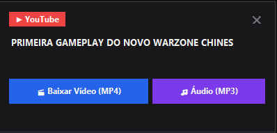

<div align="center">

# ⚡ SnapGrab

**O baixador de vídeos e áudios com zero fricção para Windows.**  
*Basta copiar o link (`Ctrl + C`) de qualquer rede social e baixar em 1 clique.*

[](https://www.python.org/)
[](https://github.com/yt-dlp/yt-dlp)
[](https://ffmpeg.org/)
[](https://microsoft.com/windows)
[](LICENSE)

[Português](#-sobre-o-projeto) • [English](#-english-overview) • [Como Usar](#-instalação-e-uso) • [Configurações](#-configurações)

[⬇️ Baixar SnapGrab para Windows](https://github.com/gklein7/SnapGrab/releases/latest/download/SnapGrab-Setup.exe)

---

</div>

## 💡 Por que o SnapGrab?

Chega de abrir sites cheios de pop-ups duvidosos ou abrir o terminal e digitar comandos longos toda vez que você quer salvar um vídeo para assistir offline ou editar.

O **SnapGrab** roda de forma silenciosa e leve na bandeja do Windows (`System Tray`). Ao detectar um link compatível na área de transferência, um pop-up minimalista aparece no canto da tela pronto para baixar o vídeo ou converter para áudio com **um clique**.

<div align="center">
  <br>
  
  <br><br>
</div>

---

## ✨ Recursos

- ⚡ **Zero Fricção (Clipboard Watcher)**: Monitora links em segundo plano. Copiou `Ctrl+C`, a opção de download aparece.
- 🎚️ **Controle de Resolução**: Escolha a qualidade do vídeo (**Máx/4K, 1080p, 720p, 480p**) com um toque no pop-up ou defina uma resolução padrão fixa pelo menu da bandeja.
- 🎬 **Qualidade Máxima ou Otimizada (MP4)**: Baixa e mescla automaticamente o melhor fluxo de vídeo e áudio compatível via FFmpeg.
- 🎵 **Extrator de Áudio (MP3)**: Extrai trilhas sonoras, podcasts e músicas em MP3 de alta taxa de bits (320 kbps).
- 📋 **Fila de Downloads**: Limita a concorrência e permite cancelar tarefas na fila ou em andamento.
- 🔁 **Nova tentativa**: Repita downloads com falha diretamente pela notificação.
- 📜 **Histórico local**: Consulte, abra ou repita downloads recentes pelo menu da bandeja. Os dados ficam em SQLite no perfil do Windows.
- 🧰 **FFmpeg Automático**: Já vem com resolução e suporte automático a binários FFmpeg sem exigir instalação manual no PATH do Windows.
- 🍪 **Bypass de Login (Instagram / X)**: Suporte a cookies de sessão do navegador para baixar Reels e vídeos protegidos.
- 🖥️ **Bandeja do Sistema (Tray)**: Alterne a resolução padrão, pause, retome ou baixe sob demanda pelo ícone ao lado do relógio.
- 🔒 **100% Privado e Local**: Sem envio de dados para servidores externos. Tudo roda na sua máquina.

---

## 🌐 Plataformas Suportadas

O SnapGrab suporta mais de 1.000 sites através do motor `yt-dlp`, incluindo:

| Plataforma | Suporte | Notas |
| :--- | :---: | :--- |
| **YouTube** | ✅ | Vídeos, Shorts, Playlists, Áudio MP3 |
| **Instagram** | ✅ | Reels, Publicações em Vídeo, Stories (com cookies) |
| **X (Twitter)** | ✅ | Vídeos de posts e threads |
| **TikTok** | ✅ | Vídeos sem marca d'água |
| **Reddit** | ✅ | Vídeos com áudio sincronizado |
| **Threads / Facebook** | ✅ | Vídeos públicos e reels |
| **Twitch / Vimeo** | ✅ | Clipes e vídeos sob demanda |

---

## 🚀 Instalação e Uso

### Instalação recomendada — Windows

1. [Baixe o instalador mais recente](https://github.com/gklein7/SnapGrab/releases/latest/download/SnapGrab-Setup.exe) na página de Releases.
2. Execute `SnapGrab-Setup.exe` e siga as instruções. O instalador oferece atalhos e a opção de iniciar com o Windows.

Não é necessário instalar Python nem compilar o projeto para usar essa versão.

### Executar pelo código-fonte (opcional)

Use estas instruções se quiser executar ou modificar o projeto em Python:

### Pré-requisitos
- **Windows 10 ou 11**
- **Python 3.10+** ([Baixar no python.org](https://www.python.org/downloads/))

### 1. Clonar ou Baixar o Repositório
```bash
git clone https://github.com/gklein7/SnapGrab.git
cd SnapGrab
```

### 2. Instalar Dependências
```bash
pip install -r requirements.txt
```

### 3. Iniciar o Aplicativo

Escolha a forma mais conveniente:

* **Em Segundo Plano (Recomendado)**:  
  Dê um duplo clique no arquivo `iniciar_silencioso.vbs`. Ele ficará rodando no System Tray sem janela de terminal.
* **Com Console de Logs**:  
  Dê um duplo clique em `iniciar.bat` ou rode no terminal:
  ```bash
  python main.py
  ```
* **Iniciar com o Windows**:  
  Dê um duplo clique em `instalar_atalho_inicializacao.bat` para adicionar o SnapGrab à inicialização do sistema.

### Releases

Ao publicar uma tag no formato `v*`, o workflow **Windows build** cria uma release com o instalador `SnapGrab-Setup.exe`. O link de download acima sempre aponta para a release mais recente.

---

## ⌨️ Modo Linha de Comando (CLI)

Se preferir usar o terminal diretamente, o SnapGrab também funciona como comando rápido:

```bash
# Baixar vídeo na qualidade padrão (ou máxima)
python main.py "https://www.youtube.com/watch?v=..."

# Baixar especificando resolução desejada (1080p, 720p, 480p)
python main.py "https://www.youtube.com/watch?v=..." video 1080p
python main.py "https://www.youtube.com/watch?v=..." video 720p

# Baixar apenas áudio em MP3 (320 kbps)
python main.py "https://www.youtube.com/watch?v=..." audio
```

---

## ⚙️ Configurações

As configurações do usuário são salvas em `%LOCALAPPDATA%/SnapGrab/settings.json`. A pasta padrão é `Downloads/Videos`, e o limite padrão é de dois downloads simultâneos. Exemplo:

```json
{
  "download_dir": "C:\\Users\\Gabriel\\Downloads\\Videos",
  "video_quality": "best",
  "cookie_browser": "opera",
  "toast_timeout": 12,
  "max_concurrent_downloads": 2
}
```

A resolução padrão também pode ser alterada pelo menu da bandeja. Se houver um `settings.json` antigo na pasta do projeto, o SnapGrab migra as configurações automaticamente.

---

## 📁 Estrutura do Projeto

```text
SnapGrab/
├── core/
│   ├── download_manager.py    # Fila, concorrência e cancelamento
│   ├── history.py             # Histórico local SQLite
│   ├── downloader.py          # Motor de download yt-dlp e pipelines
│   └── ffmpeg_resolver.py     # Detecção e injeção do binário FFmpeg
├── ui/
│   ├── toast.py               # Pop-up visual e barra de progresso (Tkinter)
│   └── tray.py                # Ícone na barra de tarefas (pystray)
├── clipboard_watcher.py       # Monitoramento assíncrono da área de transferência
├── config.py                  # Parâmetros e opções do usuário
├── main.py                    # Orquestrador central
├── installer/SnapGrab.iss     # Instalador do Windows
├── tests/                     # Testes unitários
├── iniciar.bat                # Inicializador com terminal
├── iniciar_silencioso.vbs      # Inicializador invisível para segundo plano
├── instalar_atalho_inicializacao.bat # Registrador de inicialização com Windows
├── requirements.txt           # Dependências Python
├── .github/workflows/         # Testes e build do instalador
└── README.md                  # Documentação
```

---

## 🇺🇸 English Overview

**SnapGrab** is a lightweight, zero-friction video and audio downloader for Windows powered by `yt-dlp` and `FFmpeg`.

[⬇️ Download the latest Windows installer](https://github.com/gklein7/SnapGrab/releases/latest/download/SnapGrab-Setup.exe). Python is not required to use the installer.

- **Automatic Clipboard Detection**: Whenever you copy (`Ctrl + C`) a video link from YouTube, Instagram, X (Twitter), TikTok, or Reddit, a non-intrusive floating toast pops up in the bottom-right corner.
- **1-Click Download & Quality Control**: Choose between high-res MP4 (Max/4K, 1080p, 720p, 480p) or 320kbps MP3 audio with instant quality pills.
- **Managed downloads**: A bounded queue supports cancellation, retries, and a local SQLite history.
- **Tray Resident & Quality Presets**: Lives silently in your Windows System Tray and lets you set your default resolution preset with a single click.
- **Embedded FFmpeg Support**: Automatically resolves static FFmpeg builds to merge streams seamlessly without manual setup.

---

## 📄 Licença

Distribuído sob a licença **MIT**. Consulte [`LICENSE`](LICENSE) para mais detalhes.

---

<div align="center">
Desenvolvido com foco em velocidade, produtividade e simplicidade.
</div>
